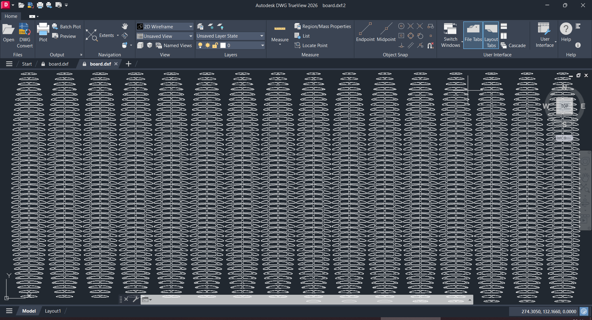

# implicit surfboard

```
Alex Laut
Apr 13 25
```

This package can be used to define a surfboard's volume implicitly, visualize and export shape and slices to dxf format.


To show the scope of the lasercutting to be required...



Earlier parametric-surface version: [legacy](legacy/)
