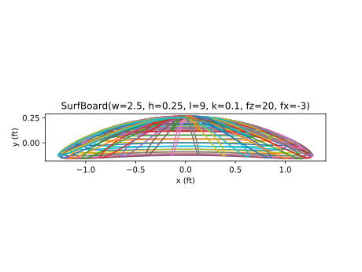
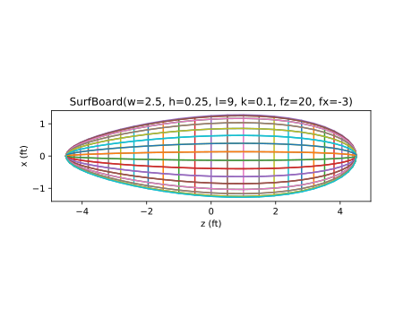
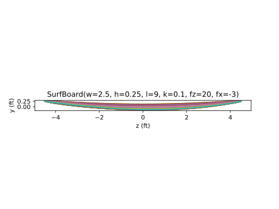
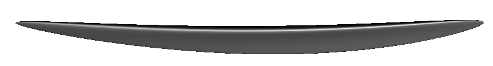

# Surfboard

```
Alex Laut
Jan 03 25
```

I decided to parameterize a type of surfboard shape in 3D. I chose to start with an ellipsoid of height $h$, width $w$, and thickness $t$. The ellipsoid is deformed by ovoid parameter $k$ and a parabolic deformations $f_x$ and $f_y$.


# Example

Here I define a surfboard 9' long, 3" thick and 2.5" wide. I define a 20' longitudinal curvature and a -3' transverse curvature. It is 10% oblong.

```python
surfboard = SurfBoard()

surfboard.triangulate(export=True)
surfboard.show()

plt.show()
```

The python object generates the following views.

| View  |           Projection           |
| :---: | :----------------------------: |
| Front |  |
|  Top  |    |
| Right |  |
|  STL  |    |

