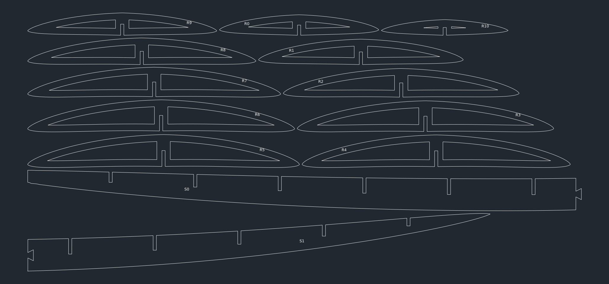

# implicit surfboard

```
Alex Laut
Apr 13 25
```

A surfboard is defined implicitly by `F(x, y, z) < 0`, previewed in 3D with a slider per parameter, and cut as a laser-cut frame: ribs cross-lapped onto a stringer that carries the rocker, skinned afterwards.


| folder     | contents                                                                                                                      |
| ---------- | ----------------------------------------------------------------------------------------------------------------------------- |
| `tools/`   | `board.py` shape, `cut.py` sections, cross-laps, dovetail splits, nesting and DXF, `view.py` sliders and frame view, `stl.py` sections of imported meshes |
| `designs/` | one executable file per board: shape and fabrication parameters                                                               |
| `tests/`   | dimensions, ellipsoid volume and area, slot mating, DXF round trip                                                            |
| `legacy/`  | earlier parametric-surface version                                                                                            |

```
pip install -r requirements.txt
python -m designs.shorty   # sliders, then frame view, then shorty.0.dxf
python -m tests.test_cut
```

Sheet for the shorty, 44″ × 30″ bed, layers `CUT` and `ENGRAVE`:



Earlier stacked-slice layout:


Earlier parametric-surface version: [legacy](legacy/)
